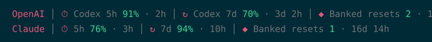
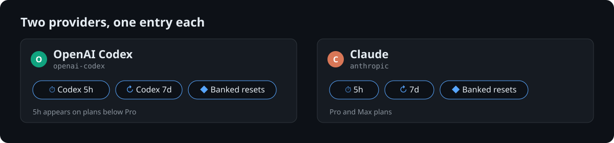
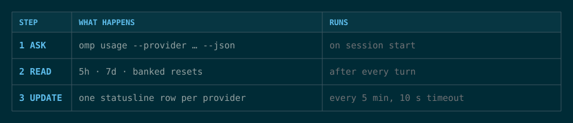
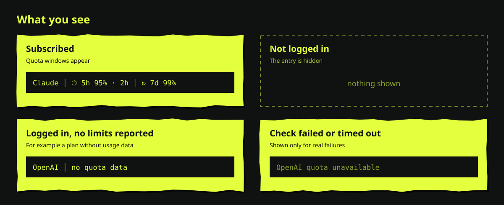
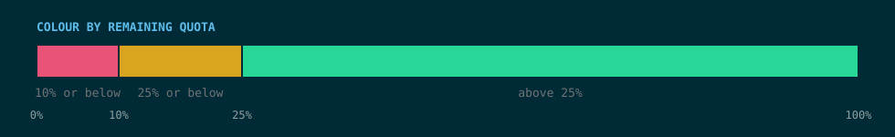

# omp-quota



<sub>Example rows. Numbers are made up.</sub>

Live subscription quota in your OMP statusline. Install either extension or both.



## Install

```sh
mkdir -p ~/.omp/agent/extensions
cp agent/extensions/openai-quota.ts ~/.omp/agent/extensions/     # OpenAI Codex
cp agent/extensions/anthropic-quota.ts ~/.omp/agent/extensions/  # Claude
```

Copy only the file for the provider you use, then restart OMP.







<details>
<summary><b>Supported providers and limits</b></summary>

- **Providers:** only OpenAI Codex (`openai-codex`) and Claude (`anthropic`). To add another, copy one extension file and change the provider id, status key, labels and the limits it reads. Each extension is self-contained.
- **Accounts:** one per provider. With several accounts for the same provider, the first matching limit is shown and accounts are not combined. `omp usage` lists every account.
- **Windows read:**
  - OpenAI: the untiered `5h` limit (only when the plan reports one) and the untiered `7d` limit.
  - Claude: the untiered `5h` and `7d` limits.
  - Limits with a tier, such as Claude `7d:fable` and the retired Spark limits, are ignored.
- **Banked resets:** the count of available reset credits and the nearest expiry, from the first report that has them.
- **Not verified:** the OpenAI `5h` match assumes an untiered `windowId: "5h"` limit and has not been checked against a real below-Pro account. OpenAI parsing is covered by unit tests only, not live data.
- **Missing entry?** Check that `omp usage --provider <id>` lists your account.

</details>

<details>
<summary><b>Test</b></summary>

```sh
bun test agent/extensions
```

</details>

<details>
<summary><b>History</b></summary>

This repo merges the former `omp-baseline`/`omp-openai-quota` and `omp-anthropic-quota` repos. OpenAI Spark limits were removed after OpenAI deprecated Spark. Early versions of the OpenAI repo also bundled OMP defaults, Semble, and a pinned Ponytail installer; see git history.

</details>
