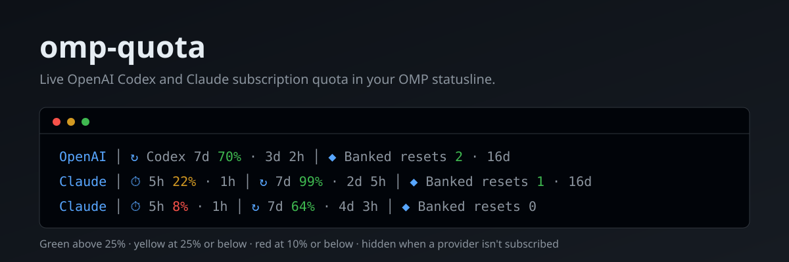

# omp-quota

OMP statusline extensions showing live subscription quota, one per provider. Install either or both.

| Extension | Provider | Shows |
|---|---|---|
| `agent/extensions/openai-quota.ts` | `openai-codex` | Codex 5h (when your plan has it, i.e. below Pro), Codex 7d, banked resets |
| `agent/extensions/anthropic-quota.ts` | `anthropic` (Claude Pro/Max) | 5h, 7d, banked resets |

    OpenAI │ ⏱ Codex 5h 91% · 2h │ ↻ Codex 7d 70% · 3d 2h │ ◆ Banked resets 2 · 16d
    Claude │ ⏱ 5h 95% · 2h │ ↻ 7d 99% · 2d 5h │ ◆ Banked resets 1 · 16d

## Install

Requires OMP. Copy the extension for each provider you use, then restart OMP:

    mkdir -p ~/.omp/agent/extensions
    cp agent/extensions/openai-quota.ts ~/.omp/agent/extensions/
    cp agent/extensions/anthropic-quota.ts ~/.omp/agent/extensions/

## Behaviour

Each extension runs `omp usage --provider <id> --json` (10 s timeout) on session start, after each turn and every 5 minutes, and keeps its own status entry.

| State | Status line |
|---|---|
| Provider has quota data | Quota windows |
| Provider not logged in (no reports, no accounts) | Nothing; the entry is hidden |
| Logged in, but `omp usage` reports no limits | `<Provider> │ no quota data` |
| `omp usage` failed or timed out | `<Provider> quota unavailable` |

With one subscription, only that provider's entry appears. With none, nothing appears. If an expected entry is missing, check that `omp usage --provider <id>` lists your account.

Colour: green above 25% remaining, yellow at 25% or below, red at 10% or below.

## Supported providers and limits

- **Providers:** only OpenAI Codex (`openai-codex`) and Claude (`anthropic`). Nothing else is read. To add another provider, copy one extension file, change the provider id, status key, labels and the limits it reads. Each extension is self-contained, with no shared module.
- **Accounts:** one account per provider. With several accounts for the same provider, the first matching limit is shown and accounts are not combined. `omp usage` lists every account.
- **Windows read:**
  - OpenAI: the untiered `5h` limit (shown only when the plan reports one) and the untiered `7d` limit.
  - Claude: the untiered `5h` and `7d` limits.
  - Limits with a tier, such as Claude `7d:fable` and the retired Spark limits, are ignored.
- **Banked resets:** the count of available reset credits and the nearest expiry, taken from the first report that has them.
- **Not verified:** the OpenAI `5h` match assumes an untiered `windowId: "5h"` limit and has not been checked against a real below-Pro account. OpenAI parsing is covered by unit tests only, not live data.

## Test

    bun test agent/extensions

## History

This repo merges the former `omp-baseline`/`omp-openai-quota` and `omp-anthropic-quota` repos. OpenAI Spark limits were removed after OpenAI deprecated Spark. Early versions of the OpenAI repo also bundled OMP defaults, Semble, and a pinned Ponytail installer; see git history.
